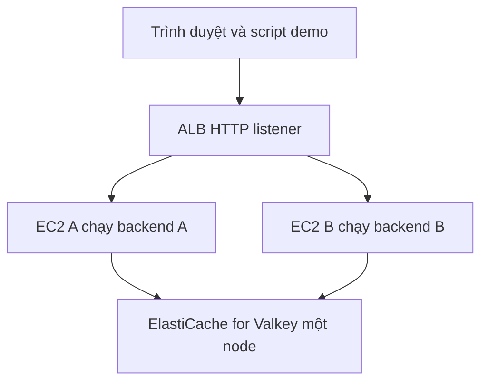

# Bàn giao demo AWS cho seminar ALB và ElastiCache

## 1. Mục tiêu và phạm vi

Thực hiện hai demo nhỏ trên **AWS thật** phục vụ seminar 20 phút. Dùng một ứng dụng lab độc lập có hai backend A/B và hai adapter lưu trữ. Kết quả bàn giao là một lab chạy được, kịch bản thao tác trong tối đa 3 phút cho mỗi demo, bằng chứng chạy thật và hướng dẫn dọn tài nguyên.

- **Demo ALB:** request qua một DNS chung được phục vụ bởi A và B; khi dừng ứng dụng A, ALB cập nhật health và các request mới qua đường mặc định tiếp tục được B phục vụ; khởi động A để khôi phục.
- **Demo ElastiCache:** so sánh dữ liệu nằm riêng trong RAM với dữ liệu dùng chung trên ElastiCache; ghi ở A, đọc và thấy thay đổi ở B; restart A khi cache vẫn chạy.
- Phạm vi tích hợp là **ứng dụng lab**, có thể đặt trong `seminar-lab/alb-elasticache/` của repo hoặc một nhánh lab riêng. Các file và endpoint dưới đây là yêu cầu cần xây, chưa phải phần đã triển khai.
- Live Quiz chỉ là tình huống ứng dụng. EKS, Kafka, RDS, autoscaling, failover Redis và toàn bộ luồng host/player không thuộc tiêu chí hoàn thành lab.
- EC2, VPC và IAM là hạ tầng hỗ trợ hai demo, không cần làm thêm chương lý thuyết về từng dịch vụ này.

## 2. Kết quả phải bàn giao

| Đầu ra | Yêu cầu |
|---|---|
| Mã ứng dụng lab | Một codebase, chạy thành A và B, có frontend HTML đơn giản và API trả `backendId` |
| Cấu hình AWS | Sơ đồ, region, resource IDs, port, SG và endpoint ALB; hướng dẫn dựng lại bằng Console/CLI hoặc IaC tách riêng |
| README chạy và demo | Các bước cài, cấu hình, reset dữ liệu, stop/start app và dọn tài nguyên; không chứa mật khẩu |
| Hai video dự phòng | Mỗi video tối đa 3 phút; ghi đúng một lần chạy của chính lab, có màn hình AWS cần đối chiếu |
| Biên bản nghiệm thu | Ngày giờ, cấu hình, kết quả từng tiêu chí; thời gian phát hiện backend lỗi; các chức năng chưa thử |
| Hướng dẫn chi phí và cleanup | Ước tính theo region, thời gian lab bật và danh sách tài nguyên đã xóa/còn giữ |

## 3. Kiến trúc được chọn



Dùng cùng một AWS account và một VPC tại **ap-southeast-1** nếu tài khoản cho phép. Tất cả tài nguyên của lab dùng tag `Project=quiz-service-seminar`; thêm tag owner/expiry nội bộ theo quy ước nhóm.

### Cấu hình tối thiểu

| Tài nguyên | Cấu hình lab |
|---|---|
| VPC | DNS support bật; hai public subnet ở hai AZ và subnet group của cache dùng private subnet cùng VPC |
| Internet Gateway | Phục vụ ALB công khai và outbound của hai EC2 ở public subnet |
| EC2 | Hai máy nhỏ x86_64, ví dụ t3.micro nếu khả dụng; mỗi máy ở một AZ; chạy cùng image/app, khác `BACKEND_ID` |
| ALB | Internet-facing, listener HTTP 80; dùng DNS AWS cấp, không bắt buộc mua domain hoặc cấu hình ACM cho lab |
| Backend | HTTP 3000; Node.js 24 và Docker; frontend HTML/JS đơn giản, tránh build thêm một frontend framework |
| Target groups | `tg-main` gồm A/B; `tg-a` chỉ A; `tg-b` chỉ B; target type instance, HTTP port 3000 |
| Cache | ElastiCache for Valkey node based, cluster mode disabled, một primary và 0 replica; node nhỏ như cache.t4g.micro nếu region hỗ trợ |
| Cache connection | VPC endpoint, port 6379, TLS required; user/group RBAC có password riêng cho lab; backend dùng `rediss` hoặc TLS options của client |
| Cách vận hành EC2 | Ưu tiên Systems Manager Session Manager với instance profile sẵn có/phù hợp; không mở backend port ra Internet |

Hai EC2 có public IPv4 để nhận outbound phục vụ bootstrap và SSM trong cấu hình lab này; traffic vào ứng dụng chỉ đến từ SG của ALB. Vì vậy không cần thêm NAT Gateway cho demo. Cache dùng mạng riêng trong VPC.

RBAC: tạo một user cho ứng dụng, giới hạn key theo prefix `quizlab:*` và cho phép các lệnh cần cho kết nối, Sorted Set, GET/SET, TTL/EXPIRE và DEL trên key lab. Đối chiếu handshake của thư viện client để cấp đủ quyền. Truyền username/password tới backend ngoài Git và ngoài image; không trả chúng về frontend. Nhóm có thể dùng môi trường cấu hình riêng được bảo vệ trên mỗi EC2. Nếu dùng Terraform quản lý password thì phải tính đến việc giá trị có thể nằm trong state; không đưa state/credential vào repo.

### Security groups

| Nhóm | Inbound cần có |
|---|---|
| SG ALB | TCP 80 từ IP người trình diễn hoặc dải IP nhóm đã chọn |
| SG backend | TCP 3000 chỉ từ SG ALB |
| SG cache | TCP 6379 chỉ từ SG backend |

SSM cần instance role, agent và outbound HTTPS phù hợp. Kiểm tra quyền tạo VPC/EC2/ALB/ElastiCache và quyền sử dụng instance profile ngay đầu ngày đầu. Nếu có SCP hoặc thiếu quyền thì xử lý với người quản lý tài khoản từ đầu; đừng chờ hoàn tất code mới kiểm tra AWS.

## 4. Định tuyến ALB để demo có tính xác định

| Priority | Điều kiện | Target group | Mục đích |
|---|---|---|---|
| 10 | Path `/lab/a/*` | tg-a | Ghi/đọc đích danh A khi so sánh lưu trữ |
| 20 | Path `/lab/b/*` | tg-b | Ghi/đọc đích danh B khi so sánh lưu trữ |
| Default | Các request còn lại | tg-main | Demo phân phối A/B và health check |

Ứng dụng phải **tự bỏ prefix `/lab/a` hoặc `/lab/b` trước khi xử lý API**. Plan này không dựa vào tính năng rewrite URL trên ALB. Không giả định ALB tự xóa prefix.

- Cả ba target group dùng `GET /health`, success code 200, interval 5 giây, timeout 2 giây, healthy threshold 2, unhealthy threshold 2.
- tg-main dùng round robin và tắt cookie stickiness để minh họa HTTP; không yêu cầu mẫu nhỏ chia chính xác 50/50.
- Client gửi request với `Cache-Control: no-store`/cache buster để không đọc response cache của browser.
- Trong demo dừng A chỉ dùng đường **mặc định** để kiểm tra hệ thống còn B khỏe. Đường `/lab/a/*` cố ý pin vào A nên có thể lỗi khi A dừng; điều đó không mâu thuẫn với tg-main.
- ALB có cơ chế fail open khi toàn bộ targets trong nhóm đều unhealthy. Không dùng tình huống cả hai backend đều lỗi rồi kỳ vọng ALB có một backend khỏe để chuyển sang.
- Không đổi health check thành 503 giả trong khi vẫn gọi đó là crash tiến trình. Demo chính dừng thật ứng dụng A bằng kênh vận hành EC2.

## 5. Hợp đồng ứng dụng nhỏ

Cùng codebase cho A/B, backendId lấy từ biến môi trường. `GET /` trả giao diện lab; tất cả API trả JSON và `Cache-Control: no-store`.

| Endpoint sau khi bỏ prefix | Chức năng và response chính |
|---|---|
| `GET /health` | Kiểm tra tiến trình HTTP còn đáp ứng; không phụ thuộc Redis để demo ALB hoạt động độc lập |
| `GET /api/whoami` | `{backendId, requestId, timestamp}`; requestId mới mỗi lần |
| `GET /api/cache-status` | Kiểm tra TLS/auth/PING từ server tới cache; không lộ password hoặc thông tin nhạy cảm |
| `PUT /api/rooms/:roomId/scores/:playerId?store=memory` | Gán điểm vào Map riêng của tiến trình đích |
| `PUT /api/rooms/:roomId/scores/:playerId?store=elasticache` | Gán điểm vào Sorted Set trên ElastiCache bằng ZADD |
| `GET /api/rooms/:roomId/leaderboard?store=memory` | Đọc Map của tiến trình hiện tại và sắp xếp tương ứng |
| `GET /api/rooms/:roomId/leaderboard?store=elasticache` | Đọc top 10 theo score giảm dần từ Sorted Set chung |
| `DELETE /api/lab/rooms/:roomId?store=...` | Reset đúng dữ liệu của phòng lab; memory phải gọi riêng A/B, ElastiCache chỉ cần reset một lần |

PUT body là `{"score": 100}`. Response phải có `backendId`, `storeMode`, `roomId`, trạng thái và dữ liệu trả về. Leaderboard response mẫu:

```json
{
  "backendId": "B",
  "storeMode": "elasticache",
  "roomId": "demo",
  "leaderboard": [
    {"playerId": "bob", "score": 150},
    {"playerId": "chi", "score": 120},
    {"playerId": "alice", "score": 100}
  ]
}
```

Quy tắc:

1. Key leaderboard là `quizlab:room:<roomId>:leaderboard`, member là playerId, score là điểm tuyệt đối. Dùng `ZADD` để upsert, `ZRANGE ... REV WITHSCORES` hoặc lệnh tương đương để đọc.
2. Chọn điểm khác nhau trong demo để không phải giải thích luật hòa điểm. Lab chưa đại diện chính sách tính điểm và xếp hạng của Quiz thật.
3. TTL key bảng điểm là 3600 giây, có thể làm mới sau khi ghi. Demo TTL 15 giây chỉ là một phần mở rộng trên key khác, không dùng để làm bảng điểm chính biến mất giữa buổi.
4. Không dùng `ZINCRBY` cho nút gán điểm tuyệt đối. Gửi lại cùng `PUT score=170` phải vẫn là 170. Đây chưa phải thiết kế đồng bộ nhiều cập nhật đồng thời hoặc chống replay cho hệ Quiz thật.
5. Tái sử dụng connection tới cache trong tiến trình, không tạo connection mới cho mỗi request.
6. Nếu chọn `store=elasticache` mà không kết nối cache được, trả lỗi rõ ràng như 503. **Không tự fallback sang RAM rồi hiển thị như đã dùng ElastiCache.**
7. Kiểm tra roomId/playerId, score hợp lệ; dùng dữ liệu giả. Browser chỉ gọi backend, không có Redis client/credential ở browser.
8. `/health` là probe tiến trình phục vụ lab, còn `/api/cache-status` là kiểm tra dependency. Đừng diễn giải probe này thành đầy đủ tiêu chí readiness cho ứng dụng production.

### Giao diện tối thiểu

- Tab **ALB**: nút gửi 20 request qua `/api/whoami`, bảng backendId/requestId, đếm A/B và số lỗi.
- Tab **Shared leaderboard**: chọn roomId và store; nút ghi qua A; nút đọc từ A; nút đọc từ B; hiển thị backendId thật của response.
- Nút seed ba người chơi và update Alice 170 để không gõ lại JSON trong lúc thuyết trình.
- Hiển thị lỗi thật, không thay response lỗi bằng dữ liệu demo được hardcode.
- Thao tác stop/start backend diễn ra qua SSM/CLI riêng; không tạo nút public cho phép tắt tiến trình.

## 6. Kịch bản demo ALB trong 3 phút

| Khoảng thời gian | Thao tác | Kết quả cần quan sát |
|---|---|---|
| 0:00–0:30 | Mở DNS ALB, gửi 20 request mặc định | Có response A và B; requestId thay đổi |
| 0:30–1:10 | Qua SSM dừng container A, ví dụ `docker stop quizlab` nếu container được đặt tên này; tiếp tục request | Có thể có lỗi chuyển tiếp; AWS target health dần ghi A unhealthy, B healthy |
| 1:10–1:50 | Sau khi trạng thái ổn định, gửi 20 request qua đường mặc định | Các response thành công do B xử lý |
| 1:50–2:30 | `docker start quizlab` trên A và chờ health check | A quay lại healthy; sau đó request lại xuất hiện A/B |
| 2:30–3:00 | Chốt chức năng và giới hạn | ALB phân phối và chọn target theo health; chưa là khôi phục ván Quiz |

Container có thể dùng restart policy `unless-stopped` để sau `docker stop` không bị tự khởi động ngay và che mất tình huống lỗi. Chuẩn bị sẵn hai session SSM và vị trí target group trong console.

**Tiêu chí đạt ALB:** quan sát được cả A/B trước lỗi; A chuyển unhealthy khi app bị dừng; B tiếp tục phục vụ khi ổn định; A phục vụ lại sau restart. Ghi thời gian phát hiện thực tế, không lấy 5 giây nhân 2 làm số đo đã đạt.

## 7. Kịch bản demo ElastiCache trong 3 phút

Trước demo phải khôi phục A healthy, xác nhận cache connected và reset phòng `demo` ở cả hai store.

| Khoảng thời gian | Thao tác | Kết quả cần quan sát |
|---|---|---|
| 0:00–0:30 | Memory: ghi Alice 100 qua `/lab/a/...`; đọc cùng phòng qua `/lab/b/...` | A có Alice, B rỗng; có backendId để xác nhận đúng máy |
| 0:30–1:10 | Chọn ElastiCache, seed Alice 100, Bob 150, Chi 120 qua A; đọc qua B | B đọc Bob 150, Chi 120, Alice 100 |
| 1:10–1:40 | Ghi Alice 170 qua A; đọc lại qua B | Alice lên đầu, score 170; gửi lại cùng PUT không tăng thêm |
| 1:40–2:20 | Dừng app A; đọc cache qua đường pin B | B vẫn đọc được bảng điểm vì cache vẫn hoạt động |
| 2:20–3:00 | Khởi động A, đọc lại qua A và mở trạng thái ElastiCache trên console | Dữ liệu chung vẫn có; xác nhận cache chạy trên AWS thật |

Nếu health check của tg-a chưa cập nhật healthy sau restart, chờ hoặc dùng clip dự phòng; không làm quá thời lượng. Có thể lược bước đọc lại A trong live nếu đã có bằng chứng ở video và B đã đọc thành công.

**Tiêu chí đạt ElastiCache:** memory A/B độc lập; remote A/B dùng cùng key và dữ liệu; thứ tự điểm đúng sau cập nhật; restart A không làm mất dữ liệu trên cache đang chạy; không có fallback giả.

**Không kết luận:** đã demo cache failover, đã tăng tốc so với DB, đã đồng bộ pipeline điểm của repo hoặc đã đo sức chứa toàn hệ thống.

## 8. Phân công và lịch hai ngày

Các vai dưới đây có thể gộp cho một người; không giả định cần tuyển thêm người.

| Vai | Đầu việc chính | Đầu ra giao người khác |
|---|---|---|
| Hạ tầng | Quyền AWS, VPC/SG, ALB/target groups/rules, EC2 và kênh stop/start | DNS ALB, instance IDs, route rules, kết quả target health |
| Ứng dụng và cache | App A/B, hai adapter memory/ElastiCache, UI/API, Valkey TLS/RBAC | Source, image/build steps, config mẫu, bộ seed/reset |
| Người trình bày và nghiệm thu | Kịch bản, kiểm tra tiêu chí, video, số quan sát và slide minh họa | Hai đoạn demo gọn, ảnh console và bảng giới hạn |

### Ngày một

1. Chốt hợp đồng API và kiểm tra quyền ngay trong giờ đầu. Chốt region và cách quản lý credential; tạo hạ tầng hỗ trợ.
2. Chạy app A/B và hoàn thành demo ALB trước, vì `/health` và `/api/whoami` không cần cache.
3. Tạo ElastiCache song song với phần viết adapter nếu có người phụ trách riêng; kiểm tra kết nối từ EC2.
4. Hoàn thành memory baseline, shared Sorted Set, các route pin A/B và UI. Cuối ngày cần chạy được bản lõi cả hai demo.

### Ngày hai

1. Sửa các lỗi mạng/TLS/health/routing; đối chiếu response, thứ tự điểm và storeMode.
2. Chạy lại toàn bộ kịch bản ít nhất ba lần để kiểm tra tính lặp lại. Chốt thứ tự reset và khôi phục A giữa hai demo.
3. Quay hai video dự phòng từ lab thật; chụp console và viết biên bản ngắn. Tập thao tác mỗi demo trong 3 phút.
4. Tập cả seminar trong 20 phút và hoàn thành cleanup. Chỉ thêm phần mở rộng khi toàn bộ lõi đã đạt.

## 9. Phần mở rộng có điều kiện

- **WebSocket echo qua ALB:** app thêm endpoint WebSocket, hiển thị backendId khi mở socket và trả lại một message echo. Ghi rõ là kiểm tra transport qua ALB, không phải phục hồi Socket.IO/room của dự án. Không cần broadcast giữa A/B. Nếu chưa làm, chỉ giải thích hỗ trợ WebSocket theo tài liệu AWS.
- **TTL trên một key phụ:** ghi một giá trị có TTL 15 giây rồi đọc lại sau khi hết hạn. Không kéo dài thời lượng live chỉ để chờ TTL.
- **Counter CloudWatch:** có thể mở metric có sẵn để hỗ trợ quan sát; không tạo thêm một pipeline monitoring riêng chỉ để hoàn thành lab.

## 10. Tình huống lỗi thường gặp

| Hiện tượng | Kiểm tra trước |
|---|---|
| ALB trả 502/503 hoặc targets unhealthy | App có bind `0.0.0.0:3000` không; SG backend có nhận SG ALB không; đúng port và `/health` không; app process/log |
| `/lab/a/...` trả 404 | App chưa strip prefix; ALB không tự rewrite theo plan này |
| HTTP luôn cùng backend | Đủ mẫu chưa; đã gọi đường mặc định chưa; target kia healthy chưa; cookie stickiness hoặc cache browser |
| Redis timeout | Đúng VPC, endpoint DNS, SG 6379 từ backend và route trong VPC |
| Redis auth/TLS lỗi | TLS required, username/password, user group đã gắn cluster chưa; quyền handshake và lệnh của client |
| Memory ở B lại thấy dữ liệu A | Có thật hai tiến trình/EC2 không; route pin có đúng target không; adapter memory có dùng nhầm remote không |
| Chọn ElastiCache nhưng không chứng minh được AWS | Kiểm tra cache-status phía server, endpoint thực, resource ID và console; cấm silent fallback |
| App A tự sống lại ngay khi stop | Cách stop có bị restart policy/systemd can thiệp không; dùng lệnh stop có kiểm soát đã thử trước |
| Không tạo được tài nguyên | Xem lỗi quyền hoặc SCP; xử lý đúng tài khoản/role được cấp từ đầu |

## 11. Chi phí và dọn tài nguyên

Không đưa số tiền ước tính cũ trong repo vào làm giá hiện hành. Trước khi tạo, ghi các lựa chọn thực tế và giá theo region từ AWS Pricing Calculator hoặc bảng giá chính thức.

Công thức kiểm tra phạm vi chi phí: thời gian bật ALB và LCU + hai EC2 + cache node + EBS + public IPv4 + data transfer phát sinh. Không dựa vào credit/Free Tier để giả định bằng 0. Nếu chỉ stop EC2 thì ALB, cache và một số khoản khác vẫn có thể tiếp tục tính phí.

Trình tự cleanup gợi ý, chỉ áp dụng tài nguyên do lab tạo:

1. Lưu mã, video và biên bản; xóa ALB rồi các listener/target groups còn lại thuộc lab sau khi hết phụ thuộc.
2. Xóa ElastiCache lab cùng subnet group/user group/users được tạo riêng sau khi tài nguyên chính xóa xong; không xóa đối tượng dùng chung của người khác.
3. Terminate EC2; kiểm tra EBS, snapshot hoặc địa chỉ tĩnh do lab tạo còn sót.
4. Xóa SG, subnet, route/Internet Gateway và VPC riêng sau khi các ENI phụ thuộc được giải phóng; không ép xóa một VPC dùng chung.
5. Ghi danh sách resource IDs đã xóa và tài nguyên chủ ý giữ. Giữ code không đồng nghĩa giữ hạ tầng đang tính tiền.

## 12. Mẫu biên bản nghiệm thu

| Tiêu chí | Kết quả thực tế | Bằng chứng |
|---|---|---|
| DNS ALB và tài nguyên AWS thật | Chưa chạy | Console/ARN đã che thông tin không cần thiết |
| Request qua tg-main thấy cả A/B | Chưa chạy | Output 20 request |
| Stop A và tg-main tiếp tục qua B | Chưa chạy | Thời gian stop, unhealthy, response B |
| Start A và quay lại healthy | Chưa chạy | Console và response sau khôi phục |
| Memory A/B độc lập | Chưa chạy | Cặp response pin A/B |
| ElastiCache ghi A đọc B | Chưa chạy | storeMode và bảng điểm |
| Alice cập nhật 170 lên đầu | Chưa chạy | Response trước/sau |
| Restart A không xóa dữ liệu remote | Chưa chạy | Read B và read A sau restart |
| Video dưới 3 phút cho từng demo | Chưa chạy | Tên file/video |
| Cleanup và chi phí theo cấu hình | Chưa chạy | Danh sách tài nguyên và ước tính/ghi nhận |

## 13. Liên hệ với repo Live Quiz

Ở commit `569e1f380dc824eba508d77d9e72083fdd1eddf3` đã đối chiếu, dữ liệu bền và điểm của dự án nằm ở PostgreSQL. Lab Sorted Set là **phương án có thể áp dụng** để nghiên cứu, không thay thế hoặc mô tả lại pipeline hiện tại. Không dùng script triển khai EKS đầy đủ của repo cho mục tiêu lab tối thiểu này.

## 14. Nguồn chính thức

- ALB: https://docs.aws.amazon.com/elasticloadbalancing/latest/application/application-load-balancers.html
- Listener và WebSocket: https://docs.aws.amazon.com/elasticloadbalancing/latest/application/load-balancer-listeners.html
- Health checks: https://docs.aws.amazon.com/elasticloadbalancing/latest/application/target-group-health-checks.html
- Routing/stickiness: https://docs.aws.amazon.com/elasticloadbalancing/latest/application/edit-target-group-attributes.html
- ElastiCache use cases: https://docs.aws.amazon.com/AmazonElastiCache/latest/dg/elasticache-use-cases.html
- Tạo Valkey node based: https://docs.aws.amazon.com/AmazonElastiCache/latest/dg/SubnetGroups.designing-cluster-pre.valkey.html
- RBAC: https://docs.aws.amazon.com/AmazonElastiCache/latest/dg/Clusters.RBAC.html
- Valkey commands: https://valkey.io/commands/zadd/ và https://valkey.io/commands/zrange/
- Giá ALB: https://aws.amazon.com/elasticloadbalancing/pricing/
- Giá ElastiCache: https://aws.amazon.com/elasticache/pricing/
