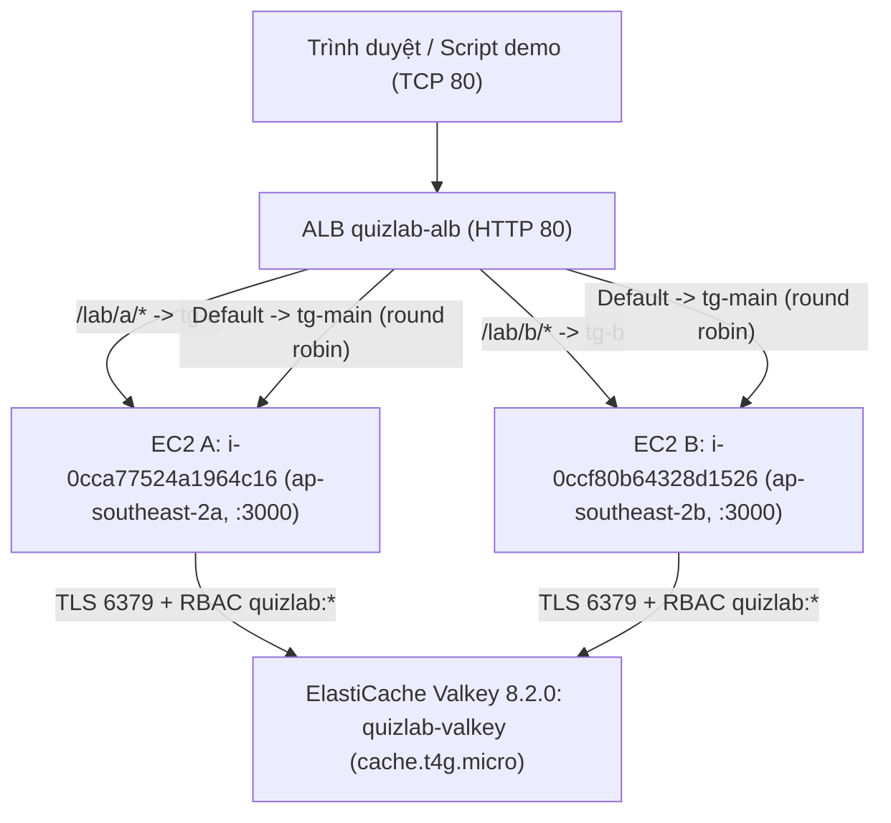

# Cấu hình AWS thực tế, Ước tính chi phí và Hướng dẫn Cleanup

Tài liệu này tổng hợp cấu hình AWS đang chạy cho 2 demo seminar ALB và ElastiCache (không chứa mật khẩu hoặc bí mật).

---

## 1. Kiến trúc thực tế đã triển khai

- **Region thực tế:** `ap-southeast-2` (Sydney)
  - *Lý do chọn `ap-southeast-2`:* `ap-southeast-1` (Singapore) và các region khác trong tài khoản bị chặn bởi Organization Service Control Policy `arn:aws:organizations::415368001562:policy/o-srarvabnmp/service_control_policy/p-3qq7zdmg`; `ap-southeast-2` là region được cấp phép (phù hợp điều kiện *"tại ap-southeast-1 nếu tài khoản cho phép"* trong Handover).
- **Tag chung mọi tài nguyên:** `Project=quiz-service-seminar`, `Owner=khoa-cli`
- **Endpoint truy cập Demo (ALB DNS):** `http://quizlab-alb-1079474885.ap-southeast-2.elb.amazonaws.com`



---

## 2. Bảng Resource IDs và Cấu hình mạng / Security Groups

### Mạng & VPC (`ap-southeast-2`)
| Tài nguyên | Tên | ID | Cấu hình |
|---|---|---|---|
| VPC | `quizlab-vpc` | `vpc-0ef86bf0b601de975` | `10.20.0.0/16`, DNS support & hostnames bật |
| Internet Gateway | `quizlab-igw` | `igw-038e8ffb953796db9` | Gắn vào `quizlab-vpc` |
| Public Subnet AZ1 | `quizlab-public-2a` | `subnet-073c999af56a95c0b` | `10.20.1.0/24` (`ap-southeast-2a`, auto public IPv4) |
| Public Subnet AZ2 | `quizlab-public-2b` | `subnet-0644bedb5397a6153` | `10.20.2.0/24` (`ap-southeast-2b`, auto public IPv4) |
| Private Subnet AZ1 | `quizlab-private-2a` | `subnet-07949064af01a3939` | `10.20.11.0/24` (`ap-southeast-2a`) |
| Private Subnet AZ2 | `quizlab-private-2b` | `subnet-093534aa4d586dc05` | `10.20.12.0/24` (`ap-southeast-2b`) |
| Route Table Public | `quizlab-rt-public` | `rtb-02a64f7cdd79309b9` | `0.0.0.0/0 -> igw-038e8ffb953796db9` |
| Route Table Private | `quizlab-rt-private` | `rtb-06c6510df171026dd` | Local only |

### Security Groups
| Security Group | ID | Inbound Rules | Outbound |
|---|---|---|---|
| `quizlab-sg-alb` | `sg-0e4de45ba1e80ee23` | TCP `80` từ IP trình diễn `117.5.142.230/32` | Default all |
| `quizlab-sg-backend` | `sg-04448c78b976fe9d4` | TCP `3000` **chỉ từ** `sg-0e4de45ba1e80ee23` | Default all |
| `quizlab-sg-cache` | `sg-0d62598f5f395beb9` | TCP `6379` **chỉ từ** `sg-04448c78b976fe9d4` | Default all |

> **Lưu ý khi đổi mạng/IP trình diễn:** Nếu trình diễn ở địa điểm khác (đổi public IP), thêm rule TCP `80` cho IP mới vào `sg-0e4de45ba1e80ee23`:
> ```bash
> aws ec2 authorize-security-group-ingress --region ap-southeast-2 --group-id sg-0e4de45ba1e80ee23 --protocol tcp --port 80 --cidr <NEW_IP>/32
> ```

### Compute (EC2), IAM & SSM
| Thành phần | Tên / ID | Cấu hình |
|---|---|---|
| EC2 Backend A | `quizlab-ec2-a` (`i-0cca77524a1964c16`) | `t3.micro`, AL2023 `ami-09a2f74ce8538e414`, `ap-southeast-2a`, `BACKEND_ID=A`, Docker container `quizlab` (`--restart unless-stopped`) |
| EC2 Backend B | `quizlab-ec2-b` (`i-0ccf80b64328d1526`) | `t3.micro`, AL2023 `ami-09a2f74ce8538e414`, `ap-southeast-2b`, `BACKEND_ID=B`, Docker container `quizlab` (`--restart unless-stopped`) |
| IAM Role | `quizlab-ec2-ssm-role` | Policy `AmazonSSMManagedInstanceCore` + inline `quizlab-read-valkey-param` (đọc `/quizlab/*`) |
| IAM Instance Profile | `quizlab-ec2-ssm-profile` (`AIPAXFTVH33CNXNGUU6LM`) | Gắn cho EC2 A và EC2 B |
| SSM Parameter | `/quizlab/valkey_password` | `SecureString` (lưu mật khẩu RBAC cho container đọc khi cấu hình `/etc/quizlab/env`) |

### Application Load Balancer & Target Groups
| Đối tượng | Tên | ARN / Cấu hình |
|---|---|---|
| ALB | `quizlab-alb` | `arn:aws:elasticloadbalancing:ap-southeast-2:493093379780:loadbalancer/app/quizlab-alb/52483b687e167356` (HTTP `80`, internet-facing) |
| Listener HTTP 80 | — | `arn:aws:elasticloadbalancing:ap-southeast-2:493093379780:listener/app/quizlab-alb/52483b687e167356/f58c8e839ad9b5c5` |
| Target Group chính | `quizlab-tg-main` | `arn:aws:elasticloadbalancing:ap-southeast-2:493093379780:targetgroup/quizlab-tg-main/f05fa96a666f818f` (`round_robin`, stickiness `false`, A + B) |
| Target Group pin A | `quizlab-tg-a` | `arn:aws:elasticloadbalancing:ap-southeast-2:493093379780:targetgroup/quizlab-tg-a/f27311f773a7ea92` (chỉ A) |
| Target Group pin B | `quizlab-tg-b` | `arn:aws:elasticloadbalancing:ap-southeast-2:493093379780:targetgroup/quizlab-tg-b/e1b0d17d40afe658` (chỉ B) |
| Health Check (cả 3 TG) | — | `GET /health`, HTTP `200`, interval `5s`, timeout `2s`, healthy `2`, unhealthy `2` |
| Rule Priority `10` | `/lab/a`, `/lab/a/*` | Forward -> `quizlab-tg-a` |
| Rule Priority `20` | `/lab/b`, `/lab/b/*` | Forward -> `quizlab-tg-b` |
| Default Rule | Các request còn lại | Forward -> `quizlab-tg-main` |

### ElastiCache for Valkey
| Thành phần | Tên / ID | Cấu hình |
|---|---|---|
| Replication Group | `quizlab-valkey` | Engine `valkey` `8.2.0`, node `cache.t4g.micro`, cluster mode disabled, 1 primary / 0 replica (`ap-southeast-2a`) |
| Endpoint | `master.quizlab-valkey.x4rjiz.apse2.cache.amazonaws.com:6379` | VPC endpoint, **TLS required** (`TransitEncryptionEnabled: true`) |
| Subnet Group | `quizlab-cache-subnet-group` | `subnet-07949064af01a3939`, `subnet-093534aa4d586dc05` |
| RBAC User Group | `quizlab-user-group` | Gồm `quizlab-app` và `quizlab-default-off` |
| RBAC App User | `quizlab-app` (username `quizlab`) | `on ~quizlab:* -@all +@connection +zadd +zrange +zrevrange +get +set +expire +ttl +del` (mật khẩu lưu ngoài Git tại `/etc/quizlab/env` & SSM `SecureString`) |
| RBAC Default User | `quizlab-default-off` (username `default`) | `off -@all` |

---

## 3. Ước tính chi phí tham khảo theo Region `ap-southeast-2`

Công thức kiểm tra phạm vi chi phí theo Mục 11 Handover: `ALB + LCU + 2 EC2 + ElastiCache node + EBS + public IPv4 + data transfer`. Không giả định Free Tier hay credit bằng `0`.

Đơn giá tham khảo (on-demand tại `ap-southeast-2` — cần đối chiếu lại trực tiếp trên AWS Pricing Calculator / AWS Billing Console theo tài khoản thực tế):
- **ALB:** ~`\$0.0252/giờ` + `\$0.008/LCU-giờ` (demo lưu lượng thấp gần ~1 LCU tối thiểu khi có traffic).
- **EC2 `t3.micro` (2 máy Linux):** ~`\$0.0132/giờ/máy` × 2 = ~`\$0.0264/giờ`.
- **Public IPv4 (2 IP gắn EC2 A/B + IP ALB):** `\$0.005/IP/giờ` cho IPv4 công cộng gắn tài nguyên EC2 (~`\$0.010/giờ` cho 2 EC2).
- **EBS `gp3` (2 volume 8 GB):** ~`\$0.096/GB-tháng` × 16 GB ≈ `\$1.54/tháng` (~`\$0.0021/giờ`).
- **ElastiCache Valkey `cache.t4g.micro` (1 node):** ~`\$0.0128/giờ`.
- **Data transfer:** tính thêm theo lưu lượng outbound thực tế phát sinh.

**Tổng ước tính khi lab đang bật (~`\$0.08–\$0.09/giờ`, chưa tính LCU cao/data transfer):**
- Nếu bật trong **4 giờ** để kiểm tra & quay video rồi cleanup: dưới ~`\$0.40`.
- Nếu quên dọn và bật cả **24 giờ**: ~`\$1.90–\$2.20/ngày`.
- *Lưu ý:* Chỉ stop EC2 vẫn bị tính phí ALB, ElastiCache node, EBS và IP tĩnh nếu còn giữ; vì vậy cần chạy cleanup ngay khi xong việc.

---

## 4. Hướng dẫn Cleanup toàn bộ tài nguyên Lab

Sau khi hoàn thành quay 2 video dự phòng và thuyết trình xong, chạy script tự động đã chuẩn bị sẵn (chỉ xóa các resource gắn tag `Project=quiz-service-seminar`):

```bash
chmod +x seminar-lab/alb-elasticache/cleanup-aws.sh
./seminar-lab/alb-elasticache/cleanup-aws.sh --yes
```

Hoặc thực hiện thủ công theo đúng 5 bước phụ thuộc trong script [cleanup-aws.sh](file:///home/khoa/projects/live-quiz/seminar-lab/alb-elasticache/cleanup-aws.sh):
1. Xóa ALB `quizlab-alb`, chờ ALB xóa xong, rồi xóa `quizlab-tg-main`, `quizlab-tg-a`, `quizlab-tg-b`.
2. Xóa ElastiCache `quizlab-valkey` và SSM Parameter `/quizlab/valkey_password`; chờ cluster xóa xong rồi xóa `quizlab-cache-subnet-group`, `quizlab-user-group`, `quizlab-app`, `quizlab-default-off`.
3. Terminate `i-0cca77524a1964c16` và `i-0ccf80b64328d1526`, chờ `instance-terminated` (kiểm tra tự xóa root EBS theo DeleteOnTermination và không còn Elastic IP / snapshot dư).
4. Chờ ENI giải phóng rồi xóa 3 Security Groups (`sg-0d62598f5f395beb9`, `sg-04448c78b976fe9d4`, `sg-0e4de45ba1e80ee23`), tách & xóa `igw-038e8ffb953796db9`, xóa 4 subnet, 2 route table và `vpc-0ef86bf0b601de975`.
5. Xóa IAM instance profile `quizlab-ec2-ssm-profile`, inline policy `quizlab-read-valkey-param`, detach `AmazonSSMManagedInstanceCore` và xóa role `quizlab-ec2-ssm-role`.

### Danh sách tài nguyên đã xóa / còn giữ
- **Trạng thái hiện tại (2026-11-26 09:28 UTC):** **Đã cleanup hoàn toàn.** Toàn bộ tài nguyên lab (`quizlab-alb`, 3 Target Groups, `quizlab-valkey` + subnet group + RBAC user group/users, SSM `/quizlab/valkey_password`, 2 EC2 `i-0cca77524a1964c16` & `i-0ccf80b64328d1526` + 2 EBS `gp3` + 2 ALB EIPs, 3 Security Groups, `igw-038e8ffb953796db9`, 4 subnets, 2 route tables `rtb-02a64f7cdd79309b9` & `rtb-06c6510df171026dd`, `vpc-0ef86bf0b601de975`, IAM role `quizlab-ec2-ssm-role` & profile `quizlab-ec2-ssm-profile`) đã được xóa sạch và kiểm chứng trên `ap-southeast-2`.
- **Tài nguyên còn giữ có chủ ý (từ trước khi làm lab):** Default VPC `vpc-03c23ad16d65cbeb4` (`IsDefault: true`), Key Pair `ec2-key` (`key-0bb871407c660c74f`), và IAM user `khoa-cli` (nên tắt/xóa Access Key khi không cần thao tác CLI nữa).
- Xem nhật ký đối chiếu cuối cùng tại [ACCEPTANCE_REPORT.md](file:///home/khoa/projects/live-quiz/docs/ACCEPTANCE_REPORT.md) và `Entry #13` trong [DEMO_WORKLOG.md](file:///home/khoa/projects/live-quiz/docs/DEMO_WORKLOG.md).
